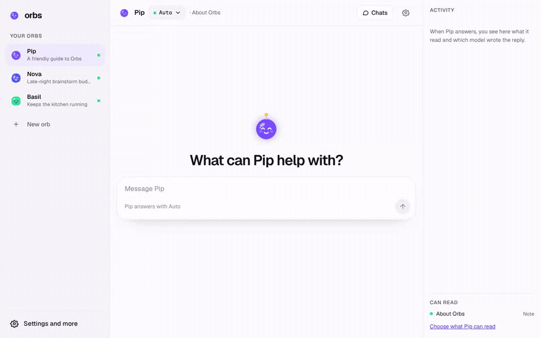
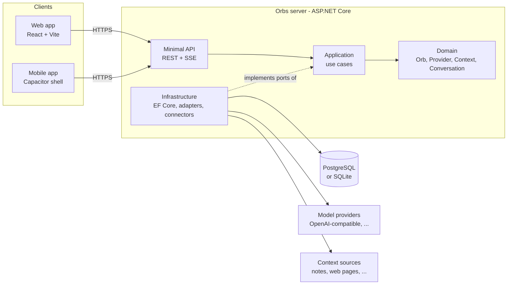

<div align="center">


# Orbs

**Little orbs. Big context.**

An open-source, self-hosted home for AI companions.
Plug in any model, connect any context and give every orb its own face.

[](https://github.com/stijntersteege/orbs/actions/workflows/ci.yml)
[](https://github.com/stijntersteege/orbs/actions/workflows/codeql.yml)
[](LICENSE)
[](CONTRIBUTING.md)

**[Live demo](https://stijntersteege.github.io/orbs/demo/)** · [Website](https://stijntersteege.github.io/orbs/) · [Docs](https://stijntersteege.github.io/orbs/docs/) · [Changelog](CHANGELOG.md)

[Quick start](#quick-start) · [Features](#features) · [Architecture](#architecture) · [Development](#development) · [Docs](docs/README.md) · [Contributing](#contributing)

<br />

<a href="https://stijntersteege.github.io/orbs/demo/"></a>

<sub>Making an orb in the <a href="https://stijntersteege.github.io/orbs/demo/">live demo</a>: name it, pick what it knows, give it a face, say hi.</sub>

</div>

---

## What is Orbs?

An **orb** is three things: **a model, its context and a face**.

- **A model**: any provider you connect. OpenAI, Anthropic, Gemini, OpenRouter, a model on your own machine, or any OpenAI-compatible endpoint.
- **Its context**: the sources it is allowed to read: notes, web pages and files. An orb sees only what you switch on.
- **A face**: color, shape, eyes, mouth and an accessory. It is how you tell your orbs apart at a glance.

Orbs can also act for you, with tools that ask before they change anything; remember what matters; work on a schedule; answer in Telegram, Matrix, Discord, Signal or email; and talk out loud. It runs on your server, keeps your data there, and works the same in the browser and on your phone.

### Principles

| | |
| --- | --- |
| **Open by default** | Any model, any context, self-hostable. Always show which model is talking and what it can see. |
| **Generic first** | Providers and context sources are plugins behind small interfaces. No vendor is special. |
| **Every orb is someone** | Customizing an orb is a first-class feature, not a skin. |
| **Playful, never childish** | The joy lives in the orbs. The interface around them stays calm, fast and accessible. |

## Features

**Orbs**
- 🟣 **Orbs** with a name, a purpose, a brief and a face of their own, with face states for listening, thinking and speaking
- 📦 **Templates**: export an orb (face, brief, voice, tools, schedules) as one file and import it anywhere

**Models**
- 🧠 **Any model**: native adapters for OpenAI-compatible APIs (OpenAI, OpenRouter, Ollama, LM Studio, vLLM, LiteLLM, ...), Anthropic and Google Gemini, with tool calling; per-orb model or "Auto"
- 🔎 **Retrieval**: set an embedding model and orbs read the passages of big sources that match the question

**Chat**
- 💬 **Streaming chat** with Markdown, tables and highlighted code; rename, delete and browse every chat; copy or delete single messages
- 👥 **Group chats**: `@mention` another orb to bring it in; orbs answer in turn and hear each other
- 📎 **Files in a chat**: drop in a PDF, document or picture for one chat, or let the orb remember it
- 🎙️ **Voice**: talk to orbs (speech-to-text) and hear them answer, each orb with its own voice

**Context and memory**
- 🔗 **Context**: notes, web pages kept in sync, and files (PDF, Word, Markdown, text, CSV, JSON, pictures); view, edit and download every source
- 🧷 **Memory**: orbs remember lasting facts, privately or shared with all your orbs; see and edit everything they remember

**Acting for you**
- 🛠️ **Tools** with per-orb permissions (allow, ask first, block), approval cards and a full audit trail
- 🔌 **Connected apps**: web search, CalDAV calendar, email and Home Assistant, plus any **MCP server**
- 🧭 **Coordinator orbs** that ask specialist orbs, and **skills**: reusable routines in the SKILL.md format
- ⏰ **Schedules**: orbs work on their own at set times, on a webhook, on new feed items or new email
- 📨 **Channels**: talk to your orbs in Telegram, Matrix, Discord, Signal or email
- 🔔 **Notifications** with Web Push and quiet hours

**Server**
- 👤 **Accounts**: passwords, passkeys or OpenID Connect; everyone sees only their own orbs; admins manage accounts
- 🔐 **Secure by default**: encrypted secrets, a strict Content Security Policy, rate-limited sign-in, private-network protection for everything Orbs fetches
- 🐳 **One container** serves the API and the web app; PostgreSQL or zero-setup SQLite; background work runs inside it
- 🌗 **Light and dark themes**, reduced-motion support, keyboard and screen-reader friendly
- 📱 **Web and mobile** from one codebase (responsive web app, PWA, Capacitor for iOS and Android)
- 🧪 **Tested**: domain, application and adapter unit tests, API integration tests, architecture rules, Reqnroll (Gherkin) specs, Vitest and Playwright
- 🧩 **Extensible**: add a provider, context connector, tool, app or channel by adding one class

A tour of everything is in [Using Orbs](docs/guides/using-orbs.md).

## Quick start

### With Docker (recommended)

```bash
git clone https://github.com/stijntersteege/orbs.git
cd orbs
cp .env.example .env     # optional: change the password, set your public URL
docker compose up -d
```

Open **http://localhost:8080** and create the first account. A demo orb called **Pip** and a demo model called **Echo** are ready, so you can try everything without an API key. Then go to **Models** and connect a real provider.

### Just the container (SQLite)

```bash
docker run -p 8080:8080 -v orbs-data:/data ghcr.io/stijntersteege/orbs:1.0.0
```

Or build it yourself: `docker build -t orbs . && docker run -p 8080:8080 -v orbs-data:/data orbs`.

### Connect a model

| Provider | Kind | Base URL |
| --- | --- | --- |
| Ollama (local) | OpenAI-compatible | `http://host.docker.internal:11434/v1` |
| LM Studio (local) | OpenAI-compatible | `http://host.docker.internal:1234/v1` |
| OpenRouter | OpenAI-compatible | `https://openrouter.ai/api/v1` |
| OpenAI | OpenAI-compatible | `https://api.openai.com/v1` |
| Anything else that speaks the OpenAI chat API | OpenAI-compatible | its `/v1` URL |
| Anthropic (Claude) | Anthropic | default, just add your key |
| Google Gemini | Google Gemini | default, just add your key |

The app has presets for these under **Models > Add provider**.

## Architecture



- **Backend**: .NET 10, ASP.NET Core Minimal APIs, Clean Architecture (Domain, Application, Infrastructure, Api), EF Core with PostgreSQL or SQLite, OpenAPI with a Scalar reference at `/scalar`.
- **Frontend**: React 19, TypeScript, Vite, React Router, TanStack Query, CSS Modules on design tokens, Capacitor for native shells.
- **Extensibility**: model providers implement `IModelAdapter`, context sources `IContextConnector`, tools `ITool`, connected apps `IIntegrationKind` and channels `IChannelAdapter`. All are registered in one place and discovered by kind.

Read the full design in the [arc42 architecture documentation](docs/architecture/README.md) and the [architecture decision records](docs/adr/README.md).

## Repository layout

```
orbs/
├── backend/                 .NET solution (Orbs.slnx)
│   ├── src/
│   │   ├── Orbs.Domain/          entities, value objects, rules; no dependencies
│   │   ├── Orbs.Application/     use cases and ports (interfaces)
│   │   ├── Orbs.Infrastructure/  EF Core, model adapters, context connectors, secrets
│   │   └── Orbs.Api/             HTTP endpoints, hosting, composition root
│   └── tests/
│       ├── Orbs.Domain.Tests/          unit tests for rules
│       ├── Orbs.Application.Tests/     use cases with in-memory fakes
│       ├── Orbs.Infrastructure.Tests/  adapter and connector units
│       ├── Orbs.Api.IntegrationTests/  the real API in memory
│       ├── Orbs.Architecture.Tests/    dependency rules (NetArchTest)
│       ├── Orbs.Specs/                 Gherkin features bound with Reqnroll
│       └── Orbs.Testing/               shared test host and API client
├── frontend/                React app for web and mobile
│   ├── src/  api/ app/ components/ features/ lib/ styles/
│   └── e2e/                 Playwright tests
├── docs/                    arc42, ADRs and guides
├── .github/                 CI, CodeQL, releases, templates
├── Dockerfile               one image: API + web app
└── compose.yaml             Orbs + PostgreSQL
```

## Development

**Prerequisites**: [.NET SDK 10](https://dotnet.microsoft.com/download), [Node.js 24](https://nodejs.org) with [pnpm](https://pnpm.io), and Docker if you want PostgreSQL or the full stack.

```bash
make setup      # restore tools and packages
make dev-api    # API on http://localhost:5080 (SQLite + demo data, API reference at /scalar)
make dev-web    # web app on http://localhost:5173 (proxies /api to the API)
```

No `make`? Every target is a plain command; see the [Makefile](Makefile) or the [development guide](docs/guides/development.md).

### Tests and checks

```bash
make test       # backend (unit, integration, architecture, specs) + frontend (Vitest)
make lint       # dotnet format, oxlint, TypeScript, Prettier
cd frontend && pnpm test:e2e   # Playwright, against a running stack
```

| Layer | Tooling | Where |
| --- | --- | --- |
| Domain and use cases | xUnit, Shouldly | `backend/tests/*.Tests` |
| API end to end in memory | WebApplicationFactory, SQLite | `Orbs.Api.IntegrationTests` |
| Behaviour (BDD) | Reqnroll + Gherkin | `Orbs.Specs/Features/*.feature` |
| Architecture rules | NetArchTest | `Orbs.Architecture.Tests` |
| Components and logic | Vitest, Testing Library | `frontend/src/**/*.test.tsx` |
| Browser end to end | Playwright (desktop and phone) | `frontend/e2e` |

See the [testing guide](docs/guides/testing.md) for the strategy.

## Configuration

Settings use standard ASP.NET Core configuration, so every key can be set as an environment variable (`:` becomes `__`).

| Setting | Default | Description |
| --- | --- | --- |
| `Database__Provider` | `Sqlite` | `Sqlite` or `Postgres` |
| `ConnectionStrings__Orbs` | `Data Source=orbs.db` | Connection string for the chosen database |
| `Orbs__PublicUrl` | `http://localhost:8080` | The address people open Orbs on (passkeys and secure cookies depend on it) |
| `Orbs__TrustForwardedHeaders` | `false` | Turn on behind a reverse proxy |
| `Orbs__ApiToken` | empty | Optional token for scripts; it acts as the first admin |
| `Orbs__Auth__Oidc__Authority` | empty | Turns on sign-in with your OpenID Connect provider |
| `Orbs__SeedDemoData` | `true` | Create the Echo provider and Pip on an empty install |
| `Orbs__Cors__Origins__0` | none | Extra origins allowed to call the API (for a separately hosted web app) |

Full list in the [configuration guide](docs/guides/configuration.md).

## Mobile

The mobile apps are the same web build inside a [Capacitor](https://capacitorjs.com) shell.

```bash
cd frontend
pnpm cap:sync
npx cap add android   # or: npx cap add ios (macOS)
pnpm cap:android      # opens Android Studio
```

On first launch, set your server address under **Settings > Server**. Details in the [mobile guide](docs/guides/mobile.md).

## Extending Orbs

- [Add a model provider](docs/guides/adding-a-model-provider.md): implement `IModelAdapter`, register it, done. The UI picks it up from `/api/providers/kinds`.
- [Add a context connector](docs/guides/adding-a-context-connector.md): implement `IContextConnector` for a new kind of source (a repository, a calendar, an API).
- [Add tools, apps and channels](docs/guides/adding-tools-apps-and-channels.md): implement `ITool`, `IIntegrationKind` or `IChannelAdapter` to let orbs act in other apps and talk in messaging apps.

## Roadmap

1.0 brings everything on the original roadmap: accounts, retrieval, files, native adapters, tools with approvals, voice and scheduled sync, and much more. Things I'd like to add some day (no dates or promises, Orbs is a hobby project):

- [ ] Native apps in the App Store and Google Play
- [ ] More connected apps and channels (contributions welcome)
- [ ] Translations of the app
- [ ] pgvector or sqlite-vec for very large knowledge bases

Deliberately not planned: payments, phone calls and a browser-automation sidecar.

Ideas welcome in [Discussions](https://github.com/stijntersteege/orbs/discussions).

## Contributing

Contributions of every size are welcome: bug reports, docs, tests, connectors, design. Start with [CONTRIBUTING.md](CONTRIBUTING.md), and look for issues labelled **good first issue**. Everyone taking part agrees to the [Code of Conduct](CODE_OF_CONDUCT.md).

Orbs is a hobby project that I work on in my spare time, so replies and reviews can take a while.

Found a vulnerability? Please report it privately; see [SECURITY.md](SECURITY.md). How data is handled is described in [PRIVACY.md](PRIVACY.md).

## License

[MIT](LICENSE) © Orbs contributors.
