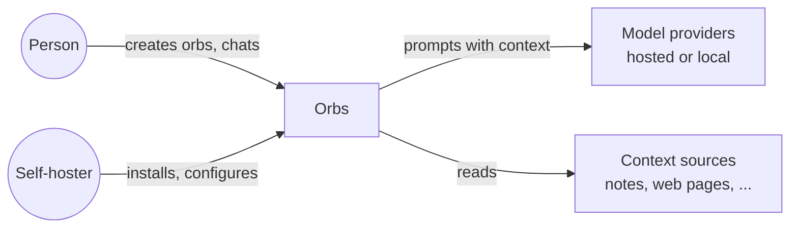
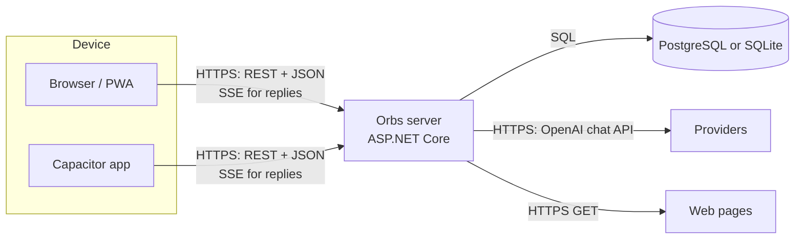

# 3. Context and scope

## Business context

| Partner | Exchanged |
| --- | --- |
| Person | Orb definitions, messages in; streamed replies, history out. |
| Model providers | Chat requests (system prompt with linked context + history) out; text fragments in. Model lists in. |
| Context sources | Content in (text of a note, a web page). Orbs never write to sources. |
| Self-hoster | Configuration (environment variables), backups, upgrades. |

## Technical context

| Channel | Protocol | Notes |
| --- | --- | --- |
| Client to server | HTTPS, JSON, `text/event-stream` | Optional bearer token (`Orbs__ApiToken`). |
| Server to database | Npgsql or SQLite | EF Core; migrations for PostgreSQL. |
| Server to providers | HTTPS, OpenAI Chat Completions with streaming | Adapter per kind; keys decrypted only for the call. |
| Server to web pages | HTTPS GET | 30 s timeout; HTML reduced to text. |

## Out of scope

Billing and payments, phone calls, a browser-automation sidecar and app-store builds are deliberately out of scope for 1.0. Accounts, tools, voice, retrieval, channels and schedules, once listed here, all shipped in 1.0.
