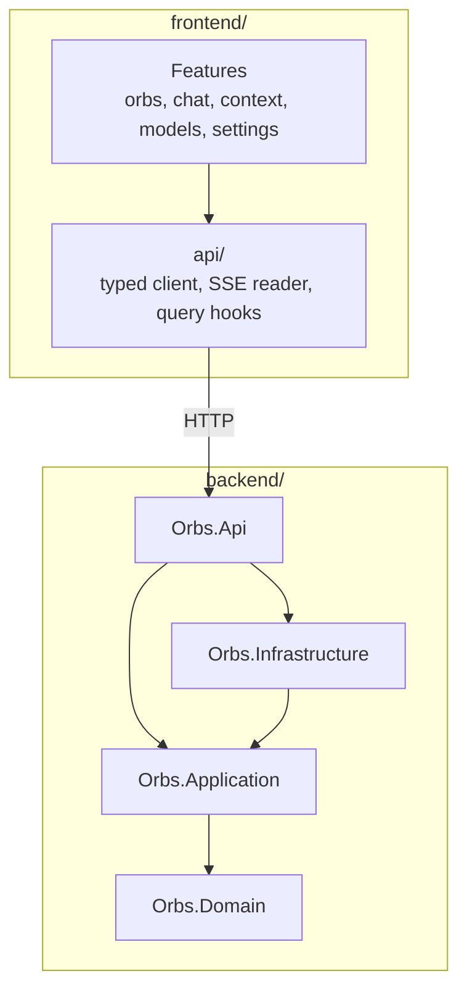
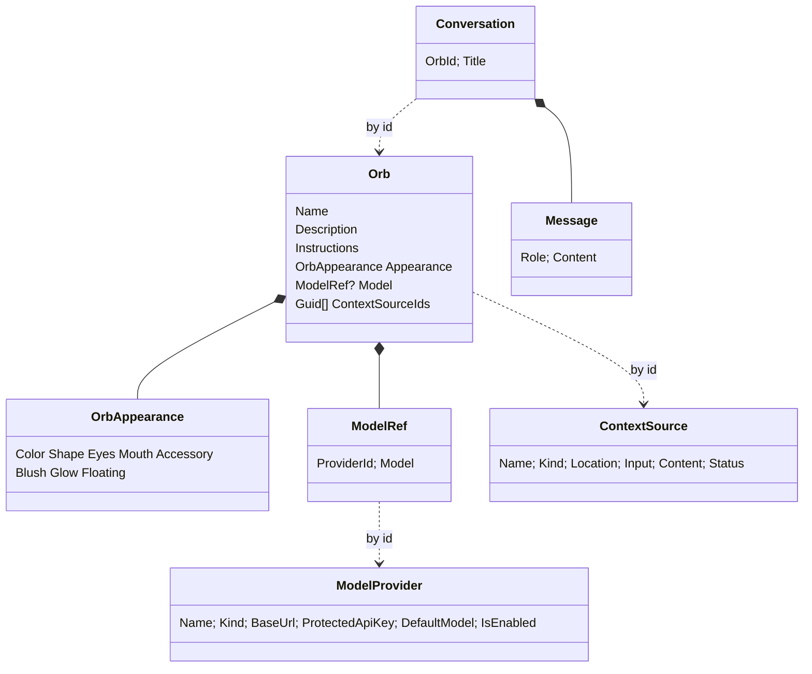
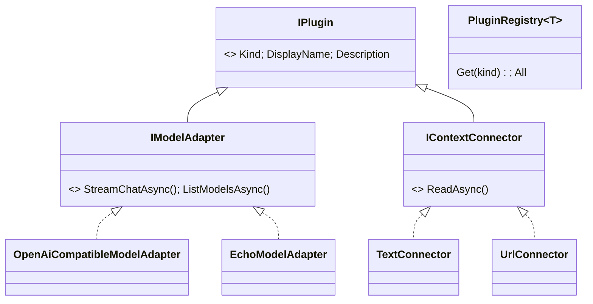

# 5. Building block view

## Level 1: system

## Level 2: backend projects

| Project | Responsibility | Depends on |
| --- | --- | --- |
| **Orbs.Domain** | Aggregates and value objects: `Orb`, `OrbAppearance`, `ModelRef`, `ModelProvider`, `ContextSource`, `Conversation`, `Message`. Guards invariants, throws `DomainException`. | nothing |
| **Orbs.Application** | Use cases (`OrbService`, `ProviderService`, `ContextService`, `ChatService`, `DemoSeeder`), pure helpers (`PromptBuilder`, `ModelResolver`), ports (`IRepository<T>`, `IUnitOfWork`, `IModelAdapter`, `IContextConnector`, `ISecretProtector`), DTOs. | Domain |
| **Orbs.Infrastructure** | EF Core `OrbsDbContext` and repositories, migrations, `OpenAiCompatibleModelAdapter`, `EchoModelAdapter`, `TextConnector`, `UrlConnector`, `DataProtectionSecretProtector`. Registers everything in `AddInfrastructure`. | Application |
| **Orbs.Api** | Composition root, endpoint groups per feature, problem-details mapping, optional API token, OpenAPI and Scalar, static web app hosting. | Application, Infrastructure |

### Domain model

Aggregates reference each other by id only, so each can be loaded and saved on its own.

### Extension points

## Level 2: frontend

| Folder | Responsibility |
| --- | --- |
| `src/api` | Types mirroring the API, a fetch client with error mapping, an SSE reader, TanStack Query hooks with one set of cache keys. |
| `src/app` | Router, providers (query client, settings), theme application. |
| `src/components` | `Orb` mascot, UI primitives (buttons, fields, switch, chips), icons, app shell (sidebar or tab bar). |
| `src/features` | One folder per screen: orbs (list, editor, orb maker), chat (page, `useChat`), context, models (with presets), settings. |
| `src/lib` | Small framework-free helpers: device settings, formatting. |
| `src/styles` | Design tokens and global styles. |
