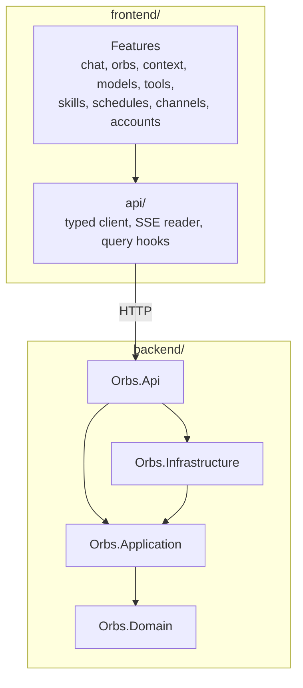
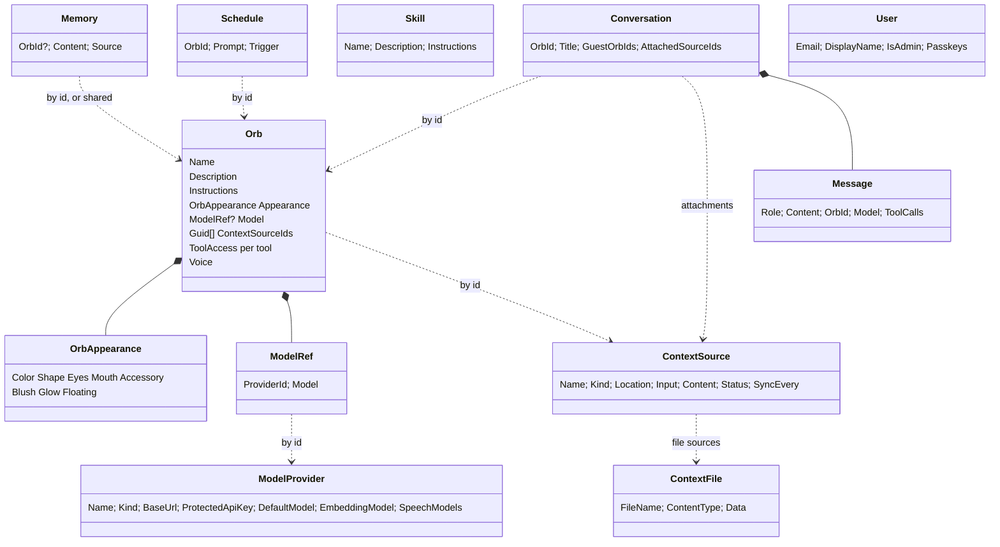
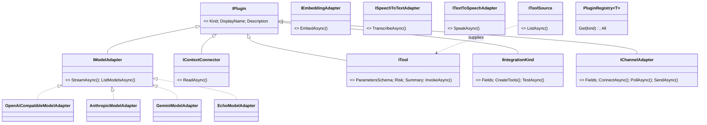

# 5. Building block view

## Level 1: system

## Level 2: backend projects

| Project | Responsibility | Depends on |
| --- | --- | --- |
| **Orbs.Domain** | Aggregates and value objects. Orbs (`Orb`, `OrbAppearance`, `ModelRef`, `ToolAccess`), `ModelProvider`, context (`ContextSource`, `ContextFile`, `ContextChunk`), chats (`Conversation`, `Message`, `ToolCallRecord`, `ToolApproval`), `Memory`, `Skill`, `Schedule`, `Job`, `Channel`, `McpServer`, `Integration`, and accounts (`User`, `Session`, `Passkey`, `PushSubscription`). Every owned aggregate derives from `OwnedAggregateRoot`. Guards invariants and throws `DomainException`. | nothing |
| **Orbs.Application** | Use cases per feature: accounts, orbs (with templates and the `ask_orb` tool), providers, context (files, sync, retrieval), chat (`ChatService`, `ReplyEngine` with the tool loop and approvals, `Mentions`, `PromptBuilder`, `ModelResolver`), tools (`ToolCatalog`, `ToolRunner`, MCP servers, integrations), memory, skills, schedules, background jobs, notifications, channels and voice. It also defines the ports: `IRepository<T>`, `IUnitOfWork`, the plugin interfaces, `IMcpClient`, `IPushSender`, `IFeedReader`, `ICronCalculator`, `IDocumentReader`, `ISecretProtector`, `IPasswordHasher` and `IPasskeyCeremonies`. | Domain |
| **Orbs.Infrastructure** | EF Core (`OrbsDbContext` and a SQLite variant, repositories, migrations per provider, an owner filter on every owned aggregate). Model adapters for OpenAI-compatible APIs, Anthropic, Gemini and Echo. Text, URL and file connectors with a document reader for PDF and Word. Integrations (web search, CalDAV, email, Home Assistant), channels (Telegram, Matrix, Discord, Signal, email) and an MCP client. Also `SafeHttp` (private-network guard), Web Push, PBKDF2 passwords, FIDO2 passkeys and Data Protection secrets. Registers everything in `AddInfrastructure`. | Application |
| **Orbs.Api** | Composition root and endpoint groups per feature. Sign-in (session cookie, bearer session token or the shared API token) and the auth middleware. Security headers and rate limits, problem-details mapping, the background `JobWorker`, OpenAPI and Scalar, and static web app hosting. | Application, Infrastructure |

### Domain model

Aggregates reference each other by id only, so each can be loaded and saved on its own. Every aggregate except `User` and `Session` has an owner, and EF Core filters queries to the signed-in person.

### Extension points

Adapters may also implement `IEmbeddingAdapter`, `ISpeechToTextAdapter` and `ITextToSpeechAdapter`. Built-in tools, MCP servers and integrations are each an `IToolSource`, so orbs see one list of tools.

## Level 2: frontend

| Folder | Responsibility |
| --- | --- |
| `src/api` | Types mirroring the API, a fetch client with error mapping, an SSE reader, TanStack Query hooks with one set of cache keys. |
| `src/app` | Router, providers (query client, settings), theme application. |
| `src/components` | `Orb` mascot with face states, the Markdown renderer (loaded on first use), UI primitives (buttons, fields, switch, chips, file button, reveal), icons, and the app shell (orbs sidebar with a settings menu; a slide-in drawer on phones). |
| `src/features` | One folder per screen: chat (page, `useChat`, activity and memory panel, chat options, all chats, voice), orbs (list, editor, orb maker, tools, voice, templates), context (list and source page), models (with presets), tools (apps, MCP servers), skills, schedules, channels, accounts and settings. |
| `src/lib` | Small helpers: device settings, formatting, downloads, media queries, passkeys (WebAuthn), Web Push, orb images. |
| `src/styles` | Design tokens and global styles. |
| `src/demo` | The in-browser demo API used by the website's live demo; it mirrors the real API's contracts. |
