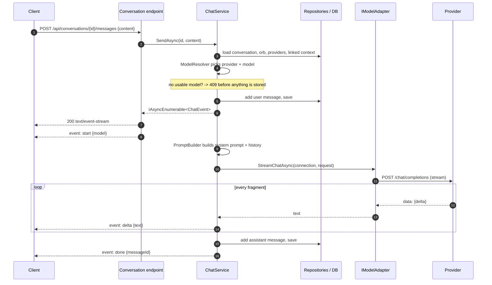

# 6. Runtime view

## Chatting with an orb



If the provider fails mid-reply, the stream ends with `event: error {text}` and no assistant message is stored; the user message stays so nothing typed is lost.

The context an orb reads is its linked sources plus files attached to the chat; with an embedding model set, `ContextRetriever` picks the passages that match the question. Memories go into the prompt too. In a group chat, every orb mentioned with `@Name` answers in turn and sees what the others said.

## Using a tool

```mermaid
sequenceDiagram
  autonumber
  participant C as Client
  participant R as ReplyEngine
  participant A as IModelAdapter
  participant T as ToolRunner
  participant X as ITool

  R->>A: StreamAsync(request with tool definitions)
  A-->>R: ToolCallOutput(call)
  R-->>C: event: tool_call
  R->>T: may this orb use the tool? (ToolAccess, risk)
  alt allowed
    T->>X: InvokeAsync(arguments)
    X-->>R: result (or an error the model reads)
    R-->>C: event: tool_result
    R->>A: continue with the result
  else asks first
    R-->>C: event: approval_required {approvalId}
    Note over C,R: the reply pauses; the approval is stored and survives a reload
    C->>R: POST /approvals/{id} {approve | deny | always}
    R->>X: InvokeAsync (when approved)
    R-->>C: event: tool_result, then the rest of the reply
  end
```

Every call, its arguments, result, duration and who allowed it are saved with the reply: the audit trail.

## Background work

1. `JobWorker` runs inside the API process. It wakes every few seconds and asks the dispatchers for due work: schedules (time, RSS, email), context sync, and channel polling.
2. Due work becomes a `Job` row owned by a person. `JobRunner` claims jobs, signs in as their owner (so the owner filter still applies) and runs the matching `IJobHandler`, retrying with back-off.
3. A schedule run sends its prompt to the orb in the schedule's own chat and notifies the owner with Web Push (respecting quiet hours).
4. Channels poll their apps (no public URL needed), pair chats with a one-time code and relay messages to the orb's chat.

## Connecting a context source

1. `POST /api/context-sources {name, kind, location | input}`.
2. `ContextService` resolves the connector for `kind` and validates what it needs (a location, or input).
3. The connector reads the source right away. Success stores the text and marks it `Ready`; failure is recorded as `Failed` with the error, and the request still succeeds so the user can fix and retry (`POST /{id}/sync`).
4. The user links the source to orbs in the orb editor.

## First start

1. The API applies migrations (PostgreSQL and SQLite each have their own).
2. With `Orbs__SeedDemoData=true` and an empty database, `DemoSeeder` adds the Echo provider, a welcome note and Pip.
3. The web app is served from `wwwroot`; unknown paths fall back to `index.html` for client-side routing.
