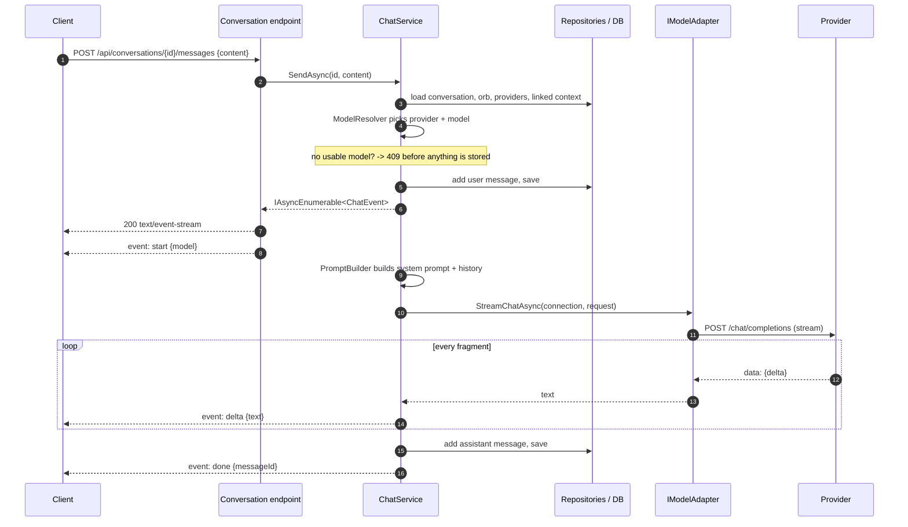

# 6. Runtime view

## Chatting with an orb

If the provider fails mid-reply, the stream ends with `event: error {text}` and no assistant message is stored; the user message stays so nothing typed is lost.

## Connecting a context source

1. `POST /api/context-sources {name, kind, location | input}`.
2. `ContextService` resolves the connector for `kind` and validates what it needs (a location, or input).
3. The connector reads the source right away. Success stores the text and marks it `Ready`; failure is recorded as `Failed` with the error, and the request still succeeds so the user can fix and retry (`POST /{id}/sync`).
4. The user links the source to orbs in the orb editor.

## First start

1. The API applies migrations (PostgreSQL) or creates the schema (SQLite).
2. With `Orbs__SeedDemoData=true` and an empty database, `DemoSeeder` adds the Echo provider, a welcome note and Pip.
3. The web app is served from `wwwroot`; unknown paths fall back to `index.html` for client-side routing.
