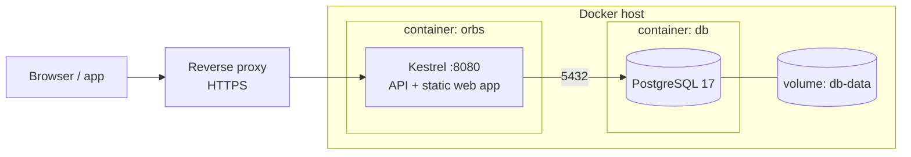

# 7. Deployment view

## Docker Compose (reference deployment)

| Element | Image | Notes |
| --- | --- | --- |
| `orbs` | built from `Dockerfile` (`ghcr.io/your-org/orbs`) | Multi-stage: Node builds the web app, the .NET SDK publishes the API, the runtime is `aspnet:10.0-alpine` running as the non-root `app` user. Health check on `/health`. |
| `db` | `postgres:17-alpine` | Data in the `db-data` volume. Port bound to `127.0.0.1` for local development only. |

## Single container (SQLite)

`docker run -p 8080:8080 -v orbs-data:/data ghcr.io/your-org/orbs` stores everything in `/data/orbs.db`. Good for one person on one machine.

## Development

| Process | Command | Port |
| --- | --- | --- |
| API | `make dev-api` | 5080 (SQLite in `backend/src/Orbs.Api/orbs.db`) |
| Web app | `make dev-web` | 5173, proxies `/api` and `/health` to 5080 |
| PostgreSQL (optional) | `docker compose up -d db` | 5432 |

## Mobile

The Capacitor shells bundle the built web app (`frontend/dist`) and talk to the server address saved in the app settings. See the [mobile guide](../guides/mobile.md).

## Releases

A `v*.*.*` tag runs the release workflow: multi-architecture image (amd64, arm64) to GHCR, tagged with the version, `major.minor` and `latest`, plus GitHub release notes.
