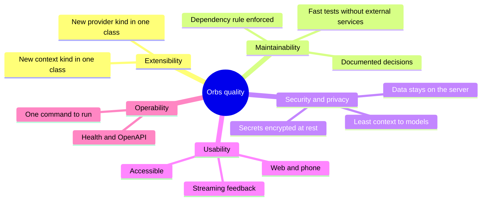

# 10. Quality requirements

## Quality tree

## Quality scenarios

| ID | Quality | Scenario | Expected response |
| --- | --- | --- | --- |
| Q1 | Extensibility | A contributor adds support for a new provider API. | One new class implementing `IModelAdapter` plus one registration line. No domain, database or UI change. The new kind appears in the UI. |
| Q2 | Extensibility | A contributor adds a new kind of context source. | One class implementing `IContextConnector`, one registration line. |
| Q3 | Maintainability | Someone adds a reference from the domain to EF Core. | The architecture tests fail in CI. |
| Q4 | Maintainability | A contributor runs all backend tests on a laptop. | All suites pass in under a minute with no database or network. |
| Q5 | Security | An attacker reads the API responses or the client storage. | No provider API key is ever present; keys exist only encrypted in the database. |
| Q6 | Privacy | An orb answers a question. | The model receives only the sources linked to that orb. |
| Q7 | Usability | A person sends a message. | The first text appears as soon as the provider streams it; the orb glows while thinking. |
| Q8 | Usability | A person uses only a keyboard or a screen reader. | Every action is reachable; controls have names; focus is visible. |
| Q9 | Operability | A self-hoster runs `docker compose up -d` on a fresh machine. | Orbs is healthy and usable with a demo orb within a minute, without an API key. |
| Q10 | Reliability | The provider fails in the middle of a reply. | The user sees a readable error; their message is kept; no half reply is stored. |
